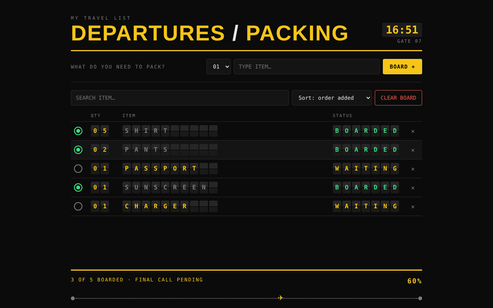
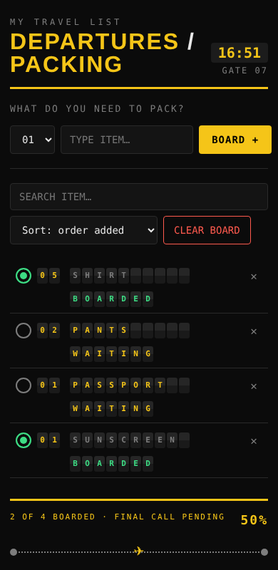

<p align="center">
  
</p>

<p align="center">
  <b>A travel packing list that looks like an airport departure board.</b><br/>
  Add what you need. Tick it off. Watch it flip from <code>WAITING</code> to <code>BOARDED</code>.
</p>

<p align="center">
  
  
  
  
</p>

<p align="center">
  <a href="https://YOUR-APP.vercel.app"></a>
</p>

<br/>

<table align="center">
  <tr>
    <td align="center"></td>
    <td align="center"></td>
  </tr>
  <tr>
    <td align="center"><sub>Desktop</sub></td>
    <td align="center"><sub>Mobile</sub></td>
  </tr>
</table>

---

## ✨ Features

| | Feature | What it does |
|:-:|---|---|
| 🛫 | **Split-flap board** | Every item is shown as letter tiles, like a real airport board |
| 🔄 | **Flip animation** | Tick an item and its tiles flip from yellow `WAITING` to green `BOARDED` |
| ➕ | **Add with quantity** | Pick how many (01–20) and type the item |
| 🔍 | **Search** | Find any item as you type |
| ↕️ | **Sort** | By order added, A–Z, waiting first, or quantity |
| 🗑️ | **Delete or clear** | Remove one item, or clear the whole board (with a confirm check) |
| ✈️ | **Flight-path stats** | A plane flies across the footer as your packed % goes up |
| 🟢 | **Ready for takeoff** | Everything turns green when you reach 100% |
| 💾 | **Saved list** | Your items are still there after you refresh |
| 🕒 | **Live clock** | The header shows the current time, like the board at the gate |
| 📱 | **Mobile friendly** | On phones, the status moves under each item so nothing gets squashed |

---

## 💭 Why a departure board?

> A packing list is really a countdown to a trip.

So instead of a plain checklist, every item becomes a *flight* waiting to board. Packing turns into a small moment: tick it, and the tiles flip.

---

## 🧩 How it's built

```
App                    state + add / toggle / delete / clear handlers
├── Logo               title and live clock
├── Form               quantity + item input, resets after adding
├── PackingList        search, sort and clear board
│   └── Item           checkbox, tiles and delete button
│       └── SplitFlap  turns text into flipping tiles
└── Stats              packed count, % and the flying plane
```

<details>
<summary><b>🔧 How the flip effect works</b></summary>
<br/>

Each tile gets a React `key` that includes the item's packed status:

```jsx
<span key={`${flipKey}-${i}`} className="flap" style={{ animationDelay: `${i * 0.03}s` }}>
```

When the status changes, the key changes, so React remounts every tile and the CSS `@keyframes flip` animation plays again. The small `animationDelay` makes the letters flip one after another, left to right.

</details>

<details>
<summary><b>📦 How state and props flow</b></summary>
<br/>

- All items live in **one `useState`** in `App`.
- `App` passes the handlers down as **props**: `onAddItem` to `Form`; `onToggleItem`, `onDeleteItem` and `onClearList` to `PackingList` and `Item`.
- **Search and sort** are worked out from the list on every render, so the saved list itself never changes order.
- **`useEffect`** saves the list to `localStorage` and keeps the clock ticking.

</details>

---

## 🛠️ Built with

| Area | Tools |
|---|---|
| **Framework** | React (Create React App) |
| **Hooks** | `useState`, `useEffect` |
| **Styling** | Plain CSS with Grid, Flexbox and `@keyframes` |
| **Fonts** | Oswald and Space Mono |
| **Hosting** | Vercel |

---

## 🚀 Run it locally

```bash
git clone https://github.com/YOUR-USERNAME/my-travel-list-app.git
cd my-travel-list-app
npm install
npm start
```

Then open **http://localhost:3000**.

<br/>

<p align="center">
  <sub>✈️ Built as a school React project · Pack light, travel far.</sub>
</p>
